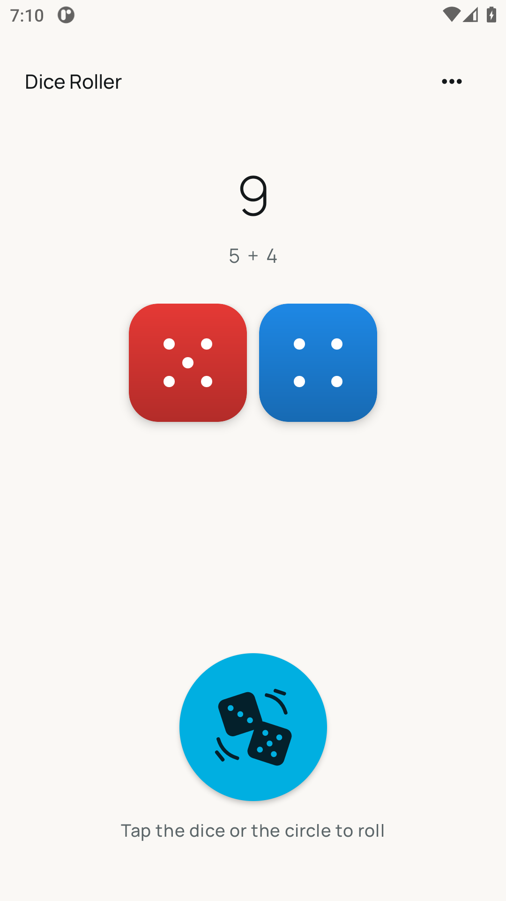
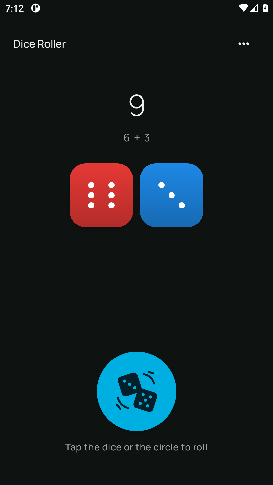
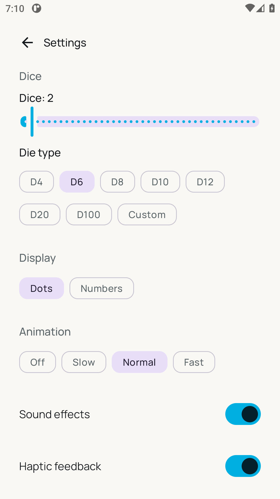
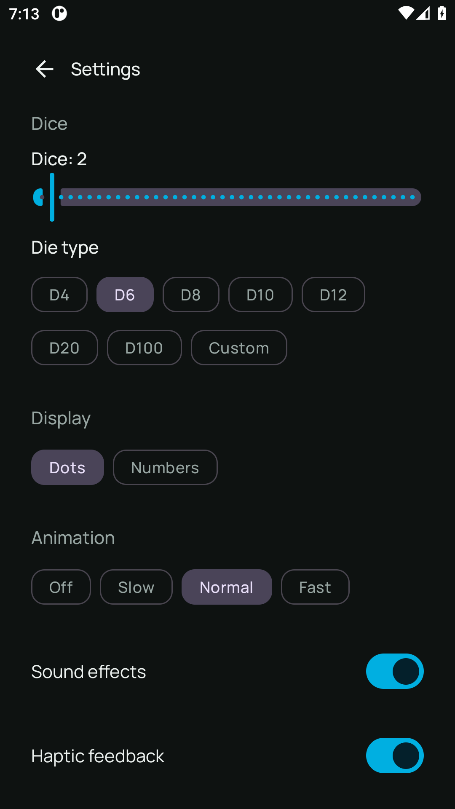
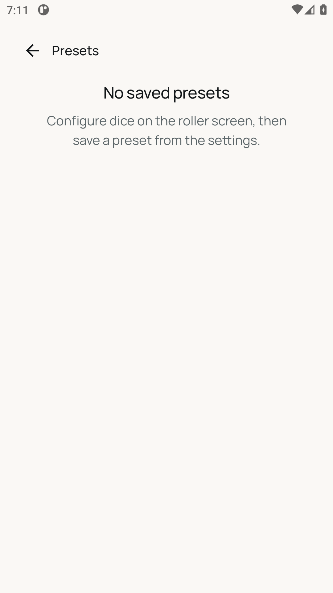

# Dice Roller for Android

[](https://github.com/patbaumgartner/dice-roller-android/actions/workflows/ci.yml)
[](https://github.com/patbaumgartner/dice-roller-android/actions/workflows/security.yml)
[](LICENSE)

Dice Roller is a free, open-source, privacy-first dice roller for board games
and tabletop RPGs. Roll 1 to 40 dice at once, from a standard D4 up to a D100
or a fully custom range, with no ads, no tracking, and no network access.

It is a clean-room reimplementation of the feature set of a popular commercial
dice-roller app, rebuilt without ads, in-app purchases, analytics, or any other
dark patterns. The app has no network permission at all: it cannot call home
because it has no way to.

## Screenshots

| | | |
| - | - | - |
|  |  | **Roller:** tap or shake to roll, lock individual dice, see the running total |
|  |  | **Settings:** display mode, animation, sound, haptics, custom range, open-source licenses |
|  | | **Presets:** save up to 10 favourite setups and load them instantly |


The launcher image is a render of the shipped vector artwork; the app screens
above are emulator captures. See [the capture guide](docs/screenshot-capture.md)
to refresh both.

Dice faces use the classic western pip layout — opposite faces sum to seven, and
the 3-face shows its diagonal. Switch to plain numerals in Settings.

## Features

- Roll 1 to 40 dice at once
- Standard dice: D4, D6, D8, D10, D12, D20, D100
- Fully custom ranges, for example 0–100 or any span in between
- Roll by tap, or optionally by shaking the device
- Lock individual dice to keep their results between rolls
- Changing die type clears locks; reducing the dice count keeps only locks for
  dice that remain
- Total of all dice shown after every roll
- Recent roll history (up to 50 rolls per session)
- Save up to 10 presets for quick access to a favourite setup
- Dot faces that match real dice, or plain numbers if you prefer
- Adjustable or disableable animation
- Sound effects and haptic feedback, both individually switchable off
- System-aware light and dark themes
- Dice expose their result and locked/unlocked state to accessibility services

## Design

The visual language matches the companion [esp32-room-watchdog-android](https://github.com/patbaumgartner/esp32-room-watchdog-android)
app to make the two apps feel like a family.

**Typography** uses the [Manrope](https://github.com/sharanda/manrope) typeface
( SIL Open Font License), bundled in four weights:

| Weight | Role |
| - | - |
| Light | Secondary labels, metadata |
| Regular | Body text, dice values, descriptions |
| Medium | Subtitles, active labels |
| Semibold | Headlines, total display, button labels |

**Colour** anchors on a brand-cyan palette with warm neutral surfaces. Both
light and dark schemes are fully defined in code and verified against the
static invariant check in `scripts/check-theme-design.mjs`.

**Icons** are four vendored [Material Design icons](https://fonts.google.com/icons)
(Apache 2.0) and an original two-dice motion icon for the larger circular roll
button. Keeping them vendored avoids the deprecated `material-icons-extended`
artifact and keeps the
APK lean. See `app/src/main/res/drawable/`.

**Launcher** artwork uses a centered white five-pip die on brand cyan. The die
spans 48% of its adaptive design canvas, leaving 26% on each side so it fits
inside the safe circle without touching the launcher mask. A dedicated
monochrome vector keeps the pip cutouts visible with Android's themed icons;
launchers apply their own adaptive mask.

**Dice** have opaque, saturated faces without a white gloss overlay. Preview
dice use the same finish as rolled dice; locked dice are darker and keep their
lock badge.

The three CI checks in `scripts/` guard the design so the pipeline catches any
drift from the intended visual language:
`node scripts/check-font-design.mjs` · `node scripts/check-icon-design.mjs` ·
`node scripts/check-theme-design.mjs`

## Privacy

- No INTERNET permission: the app cannot make a network connection
- No ads, no in-app purchases, no analytics, no tracking SDKs
- No account, no cloud, no "calling home" of any kind
- Presets and settings stay in app-private storage on the device
- Backups and device-to-device transfer of app data are disabled
- The only permission requested is `VIBRATE`, used for haptic feedback and
  fully switchable off in settings

## Requirements

- Android 8.0 (API 26) or newer
- JDK 17 to build
- Android SDK 37 with the matching build tools

The first build downloads the Gradle distribution and Android dependencies. It
can use several gigabytes of disk space in Gradle and Android SDK caches.

## Build and run

Gradle needs to know where the Android SDK is, from either an `ANDROID_HOME`
environment variable or an `sdk.dir` line in `local.properties`. Without one of
them the build stops with `SDK location not found`.

```bash
git clone https://github.com/patbaumgartner/dice-roller-android.git
cd dice-roller-android
export ANDROID_HOME="$HOME/Android/Sdk"
./gradlew :app:assembleDebug
```

The resulting debug APK is at `app/build/outputs/apk/debug/app-debug.apk`.

The release APK produced by a source checkout is unsigned. Signing and
distribution remain the responsibility of the person building the app.

## Testing

The test pyramid mirrors the architecture: fast JVM tests for the rules,
instrumented UI tests for the flows a user performs.

```bash
# Unit tests (pure JVM, no emulator): rolling rules, models, caps
./gradlew testDebugUnitTest

# End-to-end UI tests on a device or running emulator (Compose test + Espresso)
./gradlew connectedDebugAndroidTest
```

The JVM suite covers the dice domain (ranges, locking, caps, serialization)
and ViewModel state transitions, including lock reconciliation and visible
preset-storage errors. The instrumented suite drives the real app on an
emulator: roll, navigation, presets and settings screens, 40-dice layout,
accessibility lock state, and preservation of malformed preset storage.

If saved presets cannot be read, the app reports the problem without replacing
the existing data. It does not treat unreadable storage as an empty preset list.

## Validation

Run the same primary gates used by CI:

```bash
./gradlew testDebugUnitTest lintDebug assembleDebug assembleRelease
yamllint .
find . -name '*.sh' -not -path './*/build/*' -exec shellcheck {} +
node scripts/check-ci-wiring.mjs
```

CI also runs the static invariant checks in `scripts/` — pip layout, feature
wiring, animation, sound/haptics, manifest permissions, screenshots,
documentation sync, and the design checks (font, icon, theme). Run each
`node scripts/check-*.mjs` locally after changing anything they cover. The
unit-test result check confirms that the suite has no failures or skips and
contains the expected classes; it does not measure code coverage.

See [CONTRIBUTING.md](CONTRIBUTING.md) for the contributor workflow and
[docs/architecture.md](docs/architecture.md) for the design.

## License

Dice Roller is licensed under the [Apache License 2.0](LICENSE).